<div align="center">




<a href="https://www.linkedin.com/in/the-zohaib-khan-b38b00382/"></a>
<a href="mailto:zk05303@gmail.com"></a>
<a href="https://github.com/TheZohaibKhan"></a>

<br/><br/>



</div>

---

## `> whoami`

I'm **Zohaib Khan**, a Computer Engineering student from Pune who builds AI products end to end, from the model to the app people actually use. I like problems where machine learning meets a real user, and I've worked across the stack to get there:

- **Applied ML & research:** satellite sea-surface-temperature retrieval at ISRO SAC, with a 6-model ensemble on 172K+ records
- **LLM & multi-agent systems:** an AI travel planner and a GitHub Action that keeps documentation in sync with code
- **AI for real users:** AgriSmart, with crop recommendation and plant-disease detection for farmers, and AI Quiz Engine for teachers and students
- **Voice & data apps:** AIParentBot (emotion-aware voice assistant) and a renewable-energy analytics dashboard
- **Security & blockchain:** StegnoVault (AES-256 + steganography) and SEHR (health records on Ethereum)

Outside code, I served as General Secretary of the SPPU Student Council and led NSS volunteer work.

```bash
$ cat .profile
ROLE      =  AI / ML Engineer  |  ML Researcher  |  Gen AI Developer
EDU       =  B.E. Computer Engineering, SPPU  (CGPA 9.40 / 10)
EXP       =  ISRO SAC Research Intern + 3 industry internships
DOMAIN    =  Applied ML  |  LLM Agents  |  AgriTech  |  Full-Stack  |  Security
STACK     =  Python  |  TensorFlow  |  PyTorch  |  LangGraph  |  Django  |  AWS
OPEN_TO   =  AI/ML Engineer  |  MLOps / Cloud  |  Data Scientist  |  Python-Django roles
```

---

## `> ls ~/tech-stack`

<div align="center">

**Languages & Backend**<br/>
<br/><br/>

**ML, Deep Learning & Gen AI**<br/>
<br/><br/>

**Data, Cloud & DevOps**<br/>
<br/><br/>

**Frontend**<br/>


<br/>


</div>

---

## `> cat expertise.md`

| Domain | Level | What I've done with it |
| :-- | :--: | :-- |
| **Applied ML / Research** | ⭐⭐⭐⭐ | 6-model ensembles, Optuna HPO, XGBoost / LightGBM / CatBoost, CNNs (VGG19, UNet) |
| **Gen AI & LLM Agents** | ⭐⭐⭐⭐ | LangGraph multi-agent pipelines, Claude and OpenAI APIs, RAG, pgvector |
| **Backend Engineering** | ⭐⭐⭐⭐ | Django 6, DRF, FastAPI, Celery + Redis, Laravel, Spring Boot |
| **MLOps & Cloud** | ⭐⭐⭐ | Docker, GitHub Actions CI/CD, AWS (Lambda, S3, SNS), Terraform, MLflow |
| **Data Engineering** | ⭐⭐⭐ | HDF5 / PostgreSQL pipelines, ETL design, Kafka + PySpark streaming (learning) |

---

## `> ls ~/projects`

<details open>
<summary><b>AI Quiz Engine &mdash; AI-Powered Exam Platform</b></summary>
<br/>

Exam and assessment platform with separate teacher and student workflows, AI question generation, answer evaluation and learning hints.

| Aspect | Detail |
| :-- | :-- |
| **Stack** | Laravel 12 &middot; Livewire 4 &middot; PostgreSQL + pgvector &middot; multi-provider AI &middot; Render |
| **Scale** | Role-based permissions, server-side exam timing, AI usage controls, automated tests |
| **Impact** | Semantic similarity search, CSV question import, results and leaderboards |
| **Links** | [Live demo](https://ai-quiz-engine-b049.onrender.com) &middot; [Repo](https://github.com/TheZohaibKhan/AI-Quiz-Engine) |

</details>

<details open>
<summary><b>AI Travel Planner &mdash; Multi-Agent Trip Planner</b></summary>
<br/>

Multi-agent system that turns a natural-language travel request into a structured plan covering destinations, flights, stays, activities and budget.

| Aspect | Detail |
| :-- | :-- |
| **Stack** | LangGraph &middot; OpenAI Agents SDK &middot; Gemini &middot; Streamlit &middot; Supabase |
| **Scale** | Specialised agents for each part of the trip, coordinated by an orchestrator |
| **Impact** | Budget-aware itineraries with alternatives and day-by-day schedules |
| **Repo** | [openai-agents-travel-graph](https://github.com/TheZohaibKhan/openai-agents-travel-graph) |

</details>

<details open>
<summary><b>SEHR &mdash; Secure Electronic Health Records on Blockchain</b></summary>
<br/>

Decentralised EHR demo where patients, doctors and diagnostic centres interact through smart contracts, with medical files stored off-chain on IPFS.

| Aspect | Detail |
| :-- | :-- |
| **Stack** | React &middot; Solidity &middot; Web3.js &middot; MetaMask &middot; IPFS / Pinata |
| **Scale** | Role-based pages for patient, doctor, diagnostic and admin users |
| **Impact** | Record references on-chain, large files off-chain via content identifiers (CIDs) |
| **Links** | [Demo](https://thezohaibkhan.github.io/EHR/) &middot; [Repo](https://github.com/TheZohaibKhan/EHR) |

</details>

<details>
<summary><b>Renewable Energy Forecasting &amp; Solar Analytics Dashboard</b></summary>
<br/>

Interactive dashboard for uploading energy datasets, comparing prediction approaches and visualising solar power plant performance in the browser.

| Aspect | Detail |
| :-- | :-- |
| **Stack** | Next.js 15 &middot; React 19 &middot; TypeScript &middot; Tailwind CSS &middot; Chart.js |
| **Scale** | CSV / Excel upload with in-browser processing |
| **Impact** | Compares several models and reports MAE, RMSE and R&sup2; with switchable charts |
| **Links** | [Demo](https://thezohaibkhan.github.io/renewable-energy-dashboard/) &middot; [Repo](https://github.com/TheZohaibKhan/renewable-energy-dashboard) |

</details>

<details>
<summary><b>AIParentBot &mdash; Voice-Emotion Assistant (Prototype)</b></summary>
<br/>

Local Python voice assistant that records speech, estimates emotion from audio, transcribes it and replies with text-to-speech, saving chats in SQLite.

| Aspect | Detail |
| :-- | :-- |
| **Stack** | Python &middot; Librosa &middot; scikit-learn &middot; SpeechRecognition &middot; ElevenLabs &middot; SQLite |
| **Scale** | Single-user local prototype |
| **Impact** | MFCC-based emotion classifier, conversation memory, model training scripts |
| **Repo** | [AIParentBot](https://github.com/TheZohaibKhan/AIParentBot) |

</details>

<details>
<summary><b>AI Documentation Assistant &mdash; GitHub Action</b></summary>
<br/>

GitHub Action that reads a PR's code changes, finds the docs that need updating, and opens a docs PR using any OpenAI-compatible LLM.

| Aspect | Detail |
| :-- | :-- |
| **Stack** | Python &middot; GitHub Actions &middot; OpenAI-compatible LLMs |
| **Scale** | Works on any repo via PR comment commands (review-docs, update-docs, review-feature) |
| **Impact** | Checkbox review of suggested doc changes, plus spec-vs-code analysis against Jira tickets |
| **Repo** | [AI-Documentation-Assistant](https://github.com/TheZohaibKhan/AI-Documentation-Assistant) |

</details>

<details>
<summary><b>AgriSmart &mdash; AI Agriculture Platform (Crop-Prediction)</b></summary>
<br/>

Django web app for farmers with crop recommendation, fertilizer guidance, plant-disease prediction, and a crop marketplace.

| Aspect | Detail |
| :-- | :-- |
| **Stack** | Python &middot; Django &middot; TensorFlow / Keras &middot; NumPy &middot; SQLite &middot; Jupyter |
| **Scale** | Farmer and vendor roles; 10,000+ farmers and 2,400+ vendors |
| **Impact** | 95%+ disease-detection accuracy across 38 diseases; 22-crop recommendation engine |
| **Repo** | [Crop-Prediction](https://github.com/TheZohaibKhan/Crop-Prediction) |

</details>

<details>
<summary><b>StegnoVault &mdash; Secure Steganography System</b></summary>
<br/>

Web app that hides AES-256 encrypted data inside media files using Genetic Algorithm-optimised LSB steganography.

| Aspect | Detail |
| :-- | :-- |
| **Stack** | Java &middot; Spring Boot &middot; Spring Security &middot; MySQL &middot; HTML / CSS / JS |
| **Scale** | Multi-format media support with user authentication |
| **Impact** | Average PSNR 51.8 dB, SSIM above 0.9997, 6,339-character payload capacity |
| **Links** | [Live demo](https://thezohaibkhan.github.io/stegnographyBackendbyNewV004/) &middot; [Repo](https://github.com/TheZohaibKhan/stegnographyBackendbyNewV004) |

</details>

---

## `> git log --experience`

**`Sep 2025 – Dec 2025`** &nbsp;|&nbsp; **Junior Researcher Intern, AI/ML** &nbsp;·&nbsp; ISRO SAC (Space Applications Centre), Ahmedabad
- Built an automated 6-model ML ensemble on 172K+ INSAT-3DS records, reaching RMSE 0.229°C (R² = 0.991)
- Cut XGBoost RMSE from 0.28 to 0.19°C with Optuna hyperparameter optimisation
- Beat ISRO's ATBD baseline by about 80% through an end-to-end satellite data pipeline

`Python` `XGBoost` `TensorFlow` `Optuna` `HDF5`

**`Dec 2024 – Jan 2025`** &nbsp;|&nbsp; **Data Science & Analytics Intern** &nbsp;·&nbsp; Rajavi Technologies, Pune
- Performed data analysis, feature engineering and ML model evaluation
- Turned results into interactive visualisations for business insight

`Pandas` `Scikit-learn` `Visualisation`

**`Oct 2024 – Feb 2025`** &nbsp;|&nbsp; **Web Scraping Intern** &nbsp;·&nbsp; Inspacco (Prophandy Technologies), Pune, Remote
- Built Node.js scraping pipelines for multi-source data extraction and cleaning
- Produced structured CSV / JSON datasets for BI reporting

`Node.js` `ETL` `JSON / CSV`

**`Jan 2025 – Feb 2025`** &nbsp;|&nbsp; **Web Development Intern** &nbsp;·&nbsp; Veracity Software, Pune
- Developed and deployed Django web apps with REST APIs, database design and validation

`Django` `REST` `SQL`

---

## `> cat achievements.md`

| Area | Achievement |
| :-- | :-- |
| **Research** | Junior Researcher at ISRO SAC: 6-model satellite ML ensemble, RMSE 0.229°C, about 80% better than the ATBD baseline |
| **Gen AI & Agents** | Built LLM and multi-agent projects, including an AI Travel Planner and an AI Documentation Assistant GitHub Action |
| **Full-Stack AI** | Shipped AI Quiz Engine (Laravel 12 + pgvector) live on Render with automated tests, and AgriSmart for 10,000+ farmers |
| **Security** | StegnoVault: AES-256 + Genetic Algorithm steganography with average PSNR 51.8 dB and SSIM above 0.9997 |
| **Web3** | SEHR: Ethereum smart-contract health-records demo with off-chain IPFS file storage |
| **Academics** | CGPA 9.40 / 10, B.E. Computer Engineering, SPPU |
| **Leadership** | General Secretary, Student Council, SPPU (Board of Student Development) |
| **Community** | NSS College Head, 500+ volunteer hours; led inter-college hackathons and tech fests |

---

## `> cat certifications.md`

| Certification | Issuer | Date |
| :-- | :-- | :--: |
| Junior Researcher Internship | ISRO SAC, Ahmedabad | Dec 2025 |
| Mastering ChatGPT & Generative AI | Udemy | Jun 2025 |
| Python, Django Framework & HTML5 Stack | Udemy | Apr 2025 |
| Microsoft Excel: Beginner to Advanced | Udemy | Feb 2025 |


---

## `> ./github-analytics`

<div align="center">


<p align="center">
  
  
</p>


</div>

---

## `> cat current-focus.yaml`

```yaml
learning:
  - Apache Kafka + PySpark streaming
  - Terraform and serverless AWS (Lambda, S3, SNS)
  - Production LLM agents with LangGraph

building:
  - FakeNewsRadar      # 4-agent LangGraph fact-checker
  - DisasterEye        # UNet flood / wildfire detection + alerts
  - PowerGrid Sentinel # Kafka + PySpark anomaly detection

open_to:
  - AI / ML Engineer, MLOps / Cloud, Data Scientist roles
  - Python / Django backend roles
  - Research-driven teams working on real-world data
```

---

## `> ./connect`

<div align="center">

<a href="https://www.linkedin.com/in/the-zohaib-khan-b38b00382/"></a>
<a href="mailto:zk05303@gmail.com"></a>
<a href="https://github.com/TheZohaibKhan"></a>

<br/><br/>



</div>
